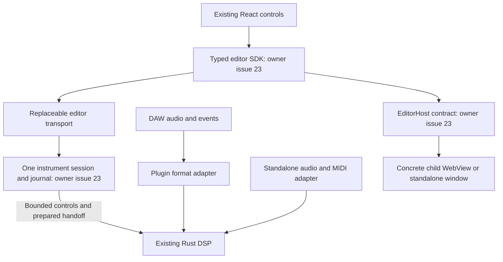

# JUCE replacement investigation — issue #24

Investigated 13 October 2026 against Dandrum [`1bdb1f8`](https://github.com/DanMarshall909/dandrum/tree/1bdb1f8e7051c6b6f45d2839b3b303a0e492c6dd). Scope: source/dependency investigation and a proposed feasibility plan. No replacement plugin, new session, dependency installation, candidate compilation, benchmark or production cutover was performed. Mutation testing is excluded at the user's request.

**Recommendation:** proceed to a bounded Clack + clap-wrapper + Wry proof, with Nice-plug as the second route if custom parameter/lifecycle work proves excessive. Both remain candidates. Actual parented React, correct VST3 parameters/state and safe teardown must determine selection. There is insufficient evidence to approve production replacement or close [#24](https://github.com/DanMarshall909/dandrum/issues/24), whose definition of done includes the full migration.

The maintainer-linked NIH-plug successor is now **RustAudio/Nice-plug**, not merely an arbitrary fork. It deserves evaluation: its current VST3 dependency has different licensing from original NIH-plug. Keeping Clack first follows #24's proposed experiment and gives an explicit format boundary; it is an engineering judgment, not a measured advantage. Do not prototype more than these two routes unless both fail a required gate and a specific missing capability justifies a follow-up.

## Scope correction — 14 October 2026

Dan confirmed that nothing has been released, so **backwards compatibility is not required**. Remove legacy JUCE-state import, old DAW-project loading, old numeric plugin/automation ID preservation and new-state-to-old-binary downgrade from the migration gates. The replacement may choose fresh product/parameter IDs and a new state format; it need not retain the JUCE wrapper's fixed 64-slot scheme. Define stable identities and versioned state for the replacement itself.

Keep working musical behaviour, existing Rust/React code and owned assets; prove new-format save/reload, host automation, supported formats and instance isolation. Existing binaries/source remain useful development comparisons, without an old-project conversion obligation. This correction supersedes the original compatibility requirements in #24; it is a planning change, not a production cutover.

## What is already independent, and what is not

The engine is an `rlib` and `staticlib`; reuse its suitable Rust API or existing C ABI. `src/juce-plugin/` is an organisational directory, not a dependency boundary. Waveform jobs, meters, commands, capture and Sound Lab controller tests already avoid a JUCE link. However, the normal root configure unconditionally reaches `add_subdirectory(third_party/JUCE)`, and the aggregate common plugin target links `juce_dsp`. Independent test executables inside that configuration do not establish a JUCE-free product build.

`DANDRUM_NATIVE_ONLY` selects a JUCE-native editor and disables browser dependencies. It does not remove JUCE. The two early-return Slint configurations avoid JUCE but are silent UI products, not the production React/Rust instrument. Both production instrument declarations include AU, VST3 and Standalone; CLAP is a new evaluation format.

The session coordinates accepted authoring state off audio; the render callback calls the engine directly. A plugin uses the DAW's audio device and event loop. A standalone owns those services. The common contracts contain neither JUCE nor successor framework types or native handles.

Source anchors: [build graph](https://github.com/DanMarshall909/dandrum/blob/1bdb1f8e7051c6b6f45d2839b3b303a0e492c6dd/CMakeLists.txt), [processor and state](https://github.com/DanMarshall909/dandrum/blob/1bdb1f8e7051c6b6f45d2839b3b303a0e492c6dd/src/juce-plugin/PluginProcessor.cpp), [editor](https://github.com/DanMarshall909/dandrum/blob/1bdb1f8e7051c6b6f45d2839b3b303a0e492c6dd/src/juce-plugin/PluginEditor.cpp), [native React adapter](https://github.com/DanMarshall909/dandrum/blob/1bdb1f8e7051c6b6f45d2839b3b303a0e492c6dd/web/trigger/engine/native-engine.mjs), [FFT measurement](https://github.com/DanMarshall909/dandrum/blob/1bdb1f8e7051c6b6f45d2839b3b303a0e492c6dd/src/juce-plugin/InstrumentUiSpectrumAnalysis.cpp).

## Responsibility and dependency register

Paths below are relative to the source baseline. A test column names existing evidence to preserve, **not a claim that it proves a replacement** or was rerun here. `Gap` means the required proof has not been located. Gates refer to J0–J6 in #24; every row remains pending cutover. Owners are current code owners, not assigned people.

| Responsibility | Current owner and dependencies | Existing proving test or gap | Proposed destination | Cutover gate |
| --- | --- | --- | --- | --- |
| Headless graph preparation, DSP, event state | `src/rust-engine/src/{preparation.rs,graph_processor,ffi.rs}`; Cargo, no JUCE | Rust unit tests; `RustEngineFfiSmoke.cpp` | Retain unchanged outside JUCE | J2 signed render through actual replacement |
| Plugin exports, activation, reset, format requests | `PluginFactory.cpp`, `PluginProcessor.*`; `juce_audio_processors`, plugin-client wrapper | `PluginConstructionTest.cpp`; gap: real format-validator/DAW receipt | Replace format adapter | J2 lifecycle, J5 format validators and DAW |
| Stereo buffers, oversized blocks, MIDI sample offsets | `PluginProcessor.cpp::processBlock`, JUCE AudioBuffer/MidiBuffer; Rust C ABI | `RustEngineSampleAccurateMidiSmoke.cpp`, `PluginSamplerHostTest.cpp` | Extract engine facade; replace conversion | J2 ordered same-offset events, signed stereo output, zero-frame/flush cases |
| Parameter objects, fixed slots, normalization, automation, gestures | `PluginProcessor.cpp`, `InstrumentUiCommands.h`; APVTS/PublicSlotParameter | `PluginHostParameterSurfaceTest.cpp`, `PluginEditorBridgeTest.cpp` | Extract semantic controls; replace format objects | J3 replacement identity/ranges/order; J2 sample-offset automation and stopped flush; old slot IDs may change |
| Transport, bypass, latency, tail, programs | Processor overrides plus JUCE wrappers; current tail returns 0, one program, no processor playhead query found | Gap: explicit transport/bypass/latency/offline host matrix | Replace current advertised format behaviour; defer new musical transport to its owner | J5 host negotiation and reset/tails/offline render; document existing limitations |
| Instrument/preset state and JUCE binary XML envelope | `PluginProcessor.cpp::{get,set}StateInformation`; ValueTree/XML/APVTS, temporary restore file | `PluginConstructionTest.cpp` tests embedded YAML and restore before preparation | Extract owned state; replace JUCE envelope with a new versioned format | J3 replacement save/reload and invalid-state rejection; no legacy importer |
| Runtime reader lifetime and prepared-engine replacement | Processor reader gate, atomics, worker coordinator, recursive non-audio mutex | `PluginEngineHandoffTest.cpp`, `NativeWaveformLifetimeTest.cpp` | Extract existing proven handoff semantics | J4 held reader, shutdown, failed replacement; off-audio reclamation |
| Background instrument preparation, cancellation, acceptance | Processor async reload jobs, Rust preparation, `SoundLabController.*`; std futures/threads | `PluginEngineHandoffTest.cpp`, `SoundLabControllerTest.cpp` | Extract services; consume #23 session acceptance | J4 stopped audio/editor loss cannot prevent completion or duplicate accepted work |
| PCM decode, assets and waveform extrema | Rust `audio_loading.rs`, `sample.rs`; standard Rust decoder | Rust decoder/sample tests, `PluginWaveformServiceTest.cpp` | Retain unchanged outside JUCE | J4 preserve decoder admission, signed extrema, source rate and coordinates |
| Waveform jobs and geometry | `InstrumentUiWaveformService.*`, `InstrumentUiWaveformGeometry.h`; standard C++, C ABI | `PluginWaveformServiceTest.cpp`, `PluginWaveformGeometryTest.cpp` | Retain unchanged outside JUCE | J4 cancellation/asset lifetime and old/new parity |
| Spectrum FFT/window/scaling | `InstrumentUiSpectrumAnalysis.*`; **JUCE FFT**, std C++ periodic Hann construction | `PluginSpectralServiceTest.cpp`, `PluginLiveAnalysisTest.cpp` | Replace FFT backend; retain measurement contract | J4 known tone/DC/Nyquist/floor/overrange equivalence |
| Prepared spectrum and live analysis workers | Spectral/Live services; indirectly JUCE via spectrum implementation | `PluginSpectralServiceTest.cpp`, `PluginLiveServiceTest.cpp`, `PluginSpectralJobTest.cpp` | Retain services; replace residual backend | J4 bounded admission, cancellation, worker lifecycle |
| Realtime meter/live capture and lossy visual delivery | `InstrumentUiMeter*.h`, `InstrumentUiLiveCapture.h`; standard C++ | Meter capture/aggregation/delivery tests, `PluginLiveCaptureTest.cpp` | Retain unchanged outside JUCE | J4/J6 bounded queues under browser stall; telemetry never becomes control authority |
| File paths, YAML staging, preset errors | Processor/configuration; JUCE File/String; `DefaultPatch.h` also uses std filesystem | `PluginConstructionTest.cpp`, `PluginDemoConfigurationTest.cpp` | Extract asset service; replace path/filesystem glue | J3 Unicode, missing assets, moved checkout, Windows drive/UNC where supported |
| File watcher and timers | `InstrumentFileWatcher.*`; JUCE Timer/File/CriticalSection; mtime/size, hash fallback, stable-poll policy | `PluginFileWatchReloadTest.cpp`, automatic-reload cases in handoff test | Replace scheduler/filesystem adapter; retain debounce/recovery policy | J4 serialized watch/restore/reprepare and shutdown |
| Editor IPC, native functions, reply serialization | `InstrumentHostWebBridge.*`, `PluginEditor.cpp`; JUCE var/JSON/browser; JS `__JUCE__` bootstrap | `PluginEditorBridgeTest.cpp`, `TriggerNativeAdapterTest.mjs`, `PluginTriggerNativeBridgeTest.cpp` | Extract typed SDK/session contract under #23; replace transport under #24 | J1 protocol identities, limits and thread rules; J4 native reconnect |
| Browser creation, resource provider, parent and visibility | `PluginEditor.*`, `PluginWebEditorFactory.cpp`; `juce_gui_extra`, WebKitGTK/WebView2/platform browser | `PluginTriggerWebRuntimeTest.h`, `PluginWebRuntimeCheck.h`; gap: replacement DAW parent | Replace concrete EditorHost view adapter | J2 true host parenting, failure, hide/show, destroy/recreate, two editors |
| Titles, size presets and standalone Options | `PluginEditor.cpp`; JUCE StandaloneFilterWindow and MenuBarModel | `PluginStandaloneChromeTest.cpp`, `TriggerNativeUiTest.mjs`, Trigger web runtime | Replace concrete window/menu adapter | J5 settings/save/load/reset and desktop chrome; DAW owns hosted chrome |
| File chooser, focus, numeric input, menus, drag/drop and DPI | Editor/browser/platform glue; JUCE FileChooser and window services | Existing browser/control tests cover subsets; gap: native replacement platform/input/scaling matrix | Replace platform services | J2/J6 100/150/200%, keyboard/text/IME, pending chooser and safe detach |
| Standalone audio/MIDI devices, configuration and hotplug | JUCE generated Standalone wrapper/AudioDeviceManager; CLI `src/juce-wrapper/Main.cpp`, MIDI callback glue | `JuceKernelSourceTest.cpp` proves callback rendering, launcher tests prove selection; gap: physical device recovery | Replace one selected device manager | J5 native drivers, rate/buffer settings, absent/lost/reconnected devices, note cleanup |
| Console demo source and MIDI queue | `RustEngineSource.*`, `MidiToRustEngine.*`, `Cli.*`; JUCE AudioSource/MIDI/File and bounded queue | `JuceKernelSourceTest.cpp`, `DrumLoopPatternTest.cpp` | Replace edge adapter; retain useful CLI fixtures | J5 maintained console behaviour; audit lifecycle separately from plugin gate |
| React/patch/WAV/font binary resources | `CMakeLists.txt`, `juce_add_binary_data`, generated BinaryData symbols, editor/configuration loaders | `ReactAssetsTest.mjs`, `PluginDemoConfigurationTest.cpp` | Replace independent resource manifest/generator | J1 no juceaide/generated-JUCE assets; J6 installed offline package |
| Native JUCE editor and Slint/JIVE experiments | `PluginNativeEditor.cpp`, `NativeOutputBuses.*`, `spikes/`, `ui/`; mixed framework dependencies | Native editor, parity and experiment tests | Defer retirement; retain as comparison/reference until explicitly decided | J6 authorized retirement after proving equivalent selected behaviour |
| Bundles, SDK flags, signing, installation | Root CMake JUCE plugin helpers; selected SDKs and platform tooling | Gap: installed replacement outside checkout, signing/notarisation receipts | Replace build/package tooling | J5 selected formats; J6 no JUCE configure/link/resource path |
| Test harness, launcher inventory and specification mapping | `CMakeLists.txt`, `scripts/demos.json`, `spec-tests.map`, launcher/check scripts | CTest names, demo launcher/inventory/boundaries, spec-coverage guard | Retain; adapt registration as products change | J6 preserve proving tests, register independent replacement paths |

The register covers first-party runtime source and explicit build relationships. It does not certify transitive system-library licensing, every optional experiment, or a final binary link audit. Those require the selected feature graph and built artifact at J6.

### Concrete findings to carry into implementation

- **JUCE DSP is not only a name:** the first-party `juce::dsp` use found is the 1024-point FFT in `InstrumentUiSpectrumAnalysis`. Its measurement contract is a periodic Hann window, 256-frame hop, one-sided peak dBFS, DC/Nyquist factor 1, other bins factor 2, and −120 dBFS floor. Rust already depends on `rustfft`, but its other spectral algorithms do not automatically match this contract. Replace the backend against the existing tone/DC/Nyquist tests; do not copy JUCE FFT implementation code.
- **Decoding is already Rust-owned:** `audio_loading.rs` admits mono/stereo 16-bit PCM WAV with validation; this investigation does not promise JUCE's broader decoder catalogue or add new formats.
- **Current automation wiring:** public musical IDs map to 64 fixed host slots `dandrum.slot.00`–`dandrum.slot.63`, each constructed with ParameterID version hint 1. Manufacturer code `Dndr` and instrument codes `Dndm`/`Dnsm` describe the current adapter. These are inventory facts, not identities or slot limits the replacement must preserve. It may bind musical parameters directly through its own stable IDs and tested ranges/defaults.
- **Automation timing differs from MIDI:** notes enter the C ABI at block-relative offsets; the processor samples changed APVTS values once before its render chunks. A successor advertising sample-accurate parameter events needs an explicit ordered engine-delivery contract. Do not route those events through the UI's last-value feedback stream or assume current block-level parameter behaviour proves sample accuracy.
- **New state needs an owned contract:** current `DandrumState` binary XML contains instrument/preset content, asset hints and parameter values. The replacement needs to round-trip its own accepted instrument, parameters and assets, with bounded validation. Reading the unreleased JUCE envelope and capturing old-state/DAW-project fixtures are outside scope.
- **History still depends on the page:** #23 owns moving accepted authoring state and serialisable undo into a single persistent session. #24 must consume that work. A replacement editor that reopens successfully cannot claim undo persistence from that alone.
- **Existing realtime safeguards are useful evidence:** the processor closes an atomic reader gate, waits off audio for readers, and destroys old engines off audio. Preserve this behaviour. Older README debt language about a shared callback lock is not sufficient evidence of the current plugin callback; the console adapter and plugin have distinct lifecycle code.

## Candidate triage and proposed selection ADR

Decision status: **proposed; native proofs pending**. The source revisions and content hashes are in [the investigation receipt](juce-replacement-receipt.json). They record what was inspected, not adopted dependency pins or Dandrum build results.

| Route | Verified upstream evidence | Dandrum assessment and rejection gate |
| --- | --- | --- |
| Clack + clap-wrapper | Clack is low-level CLAP infrastructure with evolving APIs; MIT/Apache-2.0. The MIT wrapper lists VST3, AUv2/AUv3 and a simple standalone, with separate SDK/device dependencies. | First proof route. Dandrum owns parameter/state/lifecycle policy. Reject adoption if its replacement state/parameter contract, required formats or host parenting/teardown fail. Matching unreleased JUCE IDs/envelopes is not a selection gate. Wrapper support is a possible format path, not Dandrum execution proof. |
| Nice-plug 0.4.2 | NIH-plug's maintainer link redirects to `RustAudio/nice-plug`. Pinned workspace/manifest identifies ISC framework, direct CLAP/VST3, optional CPAL/midir standalone, Rust 1.88 minimum and `vst3` 0.3 bindings. Those bindings declare MIT/Apache-2.0. | Second serious route: less parameter/wrapper infrastructure; evaluate its own state and parameter model without retaining JUCE slot constraints. AU remains a separate projection/adapter proof. Test custom React view, lifecycle and schema hooks before adoption; bundled GUI examples are not a React backend. |
| Original NIH-plug | Upstream README states maintenance mode and redirects framework users to the successor; ISC framework but GPLv3 VST3 bindings in that version. | Do not start new adoption on old framework merely because examples are familiar. Evaluate the maintained successor and its actual dependency graph. |
| Narrow C/C++ CLAP adapter + existing C ABI | Signalsmith examples illustrate CLAP glue; `webview-gui` illustrates host-native parent attachment. | Contingency if a specifically recorded Rust boundary fails. Retain proven standard C++ services. This is not a third parallel prototype or authority to grow a custom framework. |
| Existing JUCE | Working implementation and test harness; vendored module licensing remains applicable to that path. | Comparison/development fallback adapter. Retire one obligation only when its replacement row passes. |

Sources: [Clack README at inspected revision](https://github.com/prokopyl/clack/blob/27ca28391b57a61bad4bb5099288a7bf9247350d/README.md), [wrapper README](https://github.com/free-audio/clap-wrapper/blob/1cca996e96f29ab2be7ae9f8cfe532bbc92e1dd6/README.md), [NIH-plug README](https://github.com/robbert-vdh/nih-plug/blob/de421011f41a6d10fc8c7a6084e4f4dee0143683/README.md), [Nice-plug README](https://codeberg.org/RustAudio/nice-plug/src/commit/e60b5db09d8606c3dc3e93f982847a00bce17325/README.md), [Nice-plug manifest](https://codeberg.org/RustAudio/nice-plug/src/commit/e60b5db09d8606c3dc3e93f982847a00bce17325/crates/nice-plug/Cargo.toml), [vst3 0.3.0 package licence](https://docs.rs/crate/vst3/0.3.0).

### View and device choices are separate decisions

Start with Wry 0.57.0 for the replaceable view proof. Its documented child API supports HWND, NSView and Linux X11; Linux also needs GTK initialisation/loop service and explicit bounds updates. A GTK-container Wayland recipe does not prove that a non-GTK DAW parent is embeddable. Native Wayland remains unproven. Preserve system-browser runtime/dependency costs in measurements. [Child API](https://docs.rs/wry/0.57.0/wry/struct.WebViewBuilder.html#method.build_as_child)

There is an explicit ownership question for Nice-plug: Wry `WebView` is `!Send`/`!Sync`, while Nice-plug's `EditorHandle` requires `Send`. A `Send` proxy can refer to a view owned on the permitted UI thread, but this design needs synchronous close/reparent/error semantics and module-unload proof. Do not assert `unsafe impl Send` for the view to bypass the constraint. Rust's `Send` trait describes whether ownership may cross threads; it does not grant permission to call native GUI APIs on those threads. [Wry type](https://docs.rs/wry/0.57.0/wry/struct.WebView.html), [Nice-plug editor contract](https://codeberg.org/RustAudio/nice-plug/src/commit/e60b5db09d8606c3dc3e93f982847a00bce17325/crates/nice-plug-core/src/editor.rs)

The C++ view alternative currently supports Cocoa directly and uses CHOC for other platforms; its README identifies input/context-menu work still pending. Its helper involves a draft webview extension. Evaluate the underlying parent/view code only if needed; do not make Dandrum depend on a DAW implementing that draft extension. Its top-level licence was not reported by GitHub metadata, so code/attribution review is unresolved. [Inspected webview-gui README](https://github.com/geraintluff/webview-gui/blob/550f3f9141881be35758232285bf5b9699c76a99/README.md)

For standalone, compare clap-wrapper's RtAudio/RtMidi path with one CPAL/midir path, including Nice-plug's facilities if selected. CPAL's inspected development branch lists WASAPI/optional ASIO on Windows, CoreAudio on macOS, ALSA and optional Linux backends. Choose release versions against minimum OS/driver requirements; development HEAD is not a release-support promise. Neither a CLI nor port enumeration proves saved device settings/hotplug/UI recovery. Keep device libraries out of hosted plugin products. [CPAL](https://github.com/RustAudio/cpal/blob/ed8aa8200ffc9f10f7750a67942d1ec2ca651a8a/README.md), [midir](https://github.com/Boddlnagg/midir/blob/db32c3f4fa017d7145395bf04d220625d2733305/README.md)

### Licence and dependency decision still required

No top-level project LICENSE/COPYING file was found. The desired project/distribution licence, shipped OS minima and whether ASIO is required remain product decisions. This investigation changes none of them. Review selected feature-resolved transitive code, SDK versions, borrowed snippets, browser runtimes and asset/font notices before shipping; a repository-level SPDX label alone is insufficient.

The vendored JUCE licence describes AGPLv3/commercial module terms and its own dependency notices. Removing a link does not relicense copied code. Current upstream VST3 SDK MIT evidence is separate from older vendored SDK/bindings. Nice-plug's pinned manifest has 30 unconditional direct dependency entries, 14 optional; that is **not** a resolved/transitive dependency count. Candidate product lockfiles, transitive counts, local patches and final licence manifests are unavailable because no candidate was built. [Vendored JUCE licence](../../third_party/JUCE/LICENSE.md), [current VST3 SDK licence](https://github.com/steinbergmedia/vst3sdk/blob/3cdf9ca5d1f5b1b21e0a86832aa4abe55607bd96/LICENSE.txt)

## Proposed platform/format matrix and baseline availability

First **native desktop proof target proposed:** Linux x86_64, X11, CLAP then VST3, in a named Bitwig configuration plus clap-validator and the VST3 SDK validator. Native Windows x64/REAPER VST3 + HWND is the second intended desktop pass. Actual host versions, licences, installations and availability are pending. These are proposed test targets, not established support or a release-scope decision. macOS arm64 VST3/AUv2 + NSView remains required evaluation because current products declare AU; AUv3 requires a separate product decision.

| Environment / format | Current evidence inspected | Replacement status |
| --- | --- | --- |
| WSL2 x86_64 / WSLg standalone | Existing Release sampler binary, JUCE + React build configuration and SHA-256 captured; prior checked-in runtime documentation | No replacement; artifact was not rebuilt or launched here; WSLg is not native Windows or physical-device proof |
| Native Linux x86_64 X11 / CLAP | No Dandrum CLAP product declaration | Proposed first proof; no named host/validator execution |
| Native Linux x86_64 X11/XWayland / VST3 + standalone | Root product declarations; no current native desktop/DAW receipt collected | Pending native-host/device tests; XWayland is distinct from Wayland |
| Native Linux Wayland / embedded editor | Wry raw-parent child API is X11-only | Unproven; no native Wayland support claim or implicit release deferral |
| Native Windows x64 / VST3 + standalone | Product declarations; no native Windows binary/host/device receipt collected | Proposed second-OS pass; HWND/DPI/WASAPI, ASIO if selected |
| macOS arm64 / VST3, AUv2, standalone | AU/VST3 declarations; no macOS artifacts or host receipt collected | Pending NSView, signing, validator and actual DAW/device pass |
| Other architectures / AUv3 / AAX | No selected production requirement established | Product decision required; AAX/mobile/WASM excluded by #24 by default |

The receipt hashes the existing 32,297,320-byte sampler executable and baseline source/React assets. It does not establish that the retained executable was built from this exact commit. Existing builds/caches/assets were preserved. No physical listening or current callback/memory benchmark was collected. Before retiring the comparison path, capture signed-render, resource and performance baselines; a source hash alone cannot substitute for them. Old installers, wrapper state bytes, shipping IDs and old-project fixtures are not required by the prerelease scope. Historical [React resource measurements](../resource-measurements/2026-10-07-react-ui-performance/README.md) are useful measurement recipes, not fresh candidate comparisons.

## Minimum contract proposal to agree with #23

Keep one protocol/document authority owned by #23. This proposal describes its required subset without implementing a parallel SDK/session:

1. A per-instance session owns accepted document/revision, journal, assets and accepted jobs. Editor attachments carry separate identities and can be discarded without destroying the session or engine.
2. Replacement musical parameter IDs map through its format-specific IDs; retaining old JUCE IDs or slots is optional. Live UI controls have bounded begin/update/end/cancel gestures; structural edits use validate → prepare → atomic acceptance; telemetry is bounded and coalescible. Host sample-offset events remain ordered and bypass the browser/session command stream.
3. Requests carry protocol version, instance/attachment/request identity and expected revision. Responses expose rejection, accepted revision and recoverable job outcomes. Declare message/queue/journal limits, timeout/cancellation and deduplication before implementation. Encode 64-bit IDs/frame counts as decimal strings or another explicitly lossless representation across JavaScript.
4. EditorHost requests size/title/focus/visibility and asset selection via capabilities. It exposes accepted/rejected resize results; native handles, raw functions and OS path policy remain inside concrete adapters. Accepted musical state survives a cosmetic window failure.
5. The realtime facade owns prepared engine readers and bounded event delivery. Off-audio coordination prepares and reclaims resources only after reader release. No session lock, heap/history serialization, file access, GUI dispatch or runtime creation enters the callback.

Example proposed request shape: `{ protocol: 1, instance: "i1", attachment: "a2", request: "r7", expectedRevision: "42", command: { kind: "setParameter", id: "tb303.cutoff_hz", value: 1200 } }`. Exact schema, units, bounds and delivery timing must be agreed under #23; this is not a shipped endpoint. The initial JUCE transport and replacement use the same contract consumer, without emulating `window.__JUCE__` in ordinary screens.

## Bounded proof plan and stop conditions

These are future OpenSpec slices, not completed tasks, new backlog entries or automatic cutover authority.

| Slice | Required result and retained evidence | Stop condition / next route |
| --- | --- | --- |
| J0 baseline fixtures | Record musical parameter/bus semantics, resources, signed render oracles and 0/1/4-editor measurements; decide OS/driver/licence scope | Missing behavioural evidence remains explicit; old-state/project/ID compatibility fixtures are excluded |
| J1 minimum boundary | #23 contract consumer and current JUCE adapter agree ownership/protocol; independent core/resource build config never configures JUCE or invokes juceaide | SDK/OS types in common contracts or second session/journal block adoption |
| J2-A Clack headless proof | TB-303 plus literal signed stereo fixture in real CLAP host/validator; note offsets/order, parameter events, state before activation, stopped flush, reset/reactivation, two instances, no plugin-owned audio device | Failure is a recorded no-go for that requirement; fix bounded adapter gap before UI porting |
| J2-B parented React + early VST3 | Existing local production React bundle in actual host parent; one real control/gesture/feedback; repeated full destruction, failure, hide/show, resize rejection, input, two views, held-note cleanup, host-owned loop; second OS pass; VST3 processor/editor delivery | Parent, loop or module-unload failure blocks broad porting; try narrow view backend within selected route, or Nice-plug as second route |
| J3 replacement identity and state | Choose replacement plugin/parameter IDs and a framework-neutral versioned state; replacement saves → fresh replacement instance loads → document/parameters/assets/automation agree; restore before activation and reject invalid state without losing instrument | New-state or host-automation failure blocks cutover. Old JUCE/project import and old-ID equivalence are not gates; avoid duplicate IDs in scan paths |
| J4 services and session | Preserve FFT/decoder/waveform/cancellation contracts; mapping acceptance → destroy WebView → reopen → undo → original mapping and signed output; lost acknowledgement; held reader and off-audio reclamation; Trigger and TB-303 | Session-owned accepted jobs/history must not depend on UI polling. Resolve under #23 rather than adding another history |
| J5 formats/devices | Native VST3 and required AU validators/DAWs; one standalone device layer; saved settings, disconnect/reconnect, normal title/size/Options/state/reset | Name each missing format/driver/platform and its retirement gate; unresolved required JUCE path means partial migration |
| J6 hardening/package/cutover | Dense events/saturation, rate/block/reconfigure/failure matrix, allocation/lock instrumentation, idle/stalled/destroyed views, security/resource bounds, installed offline assets, licences/link maps, isolated build with JUCE absent, maintained tests/launchers, release and development fallback instructions | Reject unexplained regressions; deletion and release require applicable authorization and proven row-by-row exit gates |

For audio comparisons use 44.1/48/96 kHz, zero/small/ordinary/nonuniform/oversized blocks, same fixtures/seeds/ordered events and literal signed outputs. Compare exact same-setup values when valid; document numerical tolerance otherwise. Specifically test saturation/note releases and same-pitch overlap only to the extent the engine supports it. Unsupported dialect/expression features must not be advertised.

Before comparing resource performance, record and agree tolerances using current artifact measurements: cold/warm open and reopen; no/one/four editors and a bounded larger case; DSP/sample versus view/child-process memory; idle/active CPU; input/automation response; callback timing under stalls. No numeric improvement, binary-size reduction, realtime guarantee or browser process-sharing benefit is established by this paper assessment.

Development fallback means selecting the retained JUCE source/build and known fixtures while the replacement is being proved. It does not require importing unreleased projects or reading replacement state in JUCE. Choose prototype/replacement IDs deliberately and avoid competing binaries with identical IDs in a scan path; there is no shipping-ID preservation requirement.

## Completion accounting

This investigation delivers the source/dependency register, candidate triage and proposed ADR, pinned upstream/source receipt, current evidence limits, platform proposal, minimum shared-contract proposal and bounded implementation/verification plan. It preserves Rust/React and the separate #23 session ownership, and does not absorb unrelated musical features.

**#24's migration is still open:** J0 fixture capture/licence/release decisions are incomplete; J1–J6 native implementation and Gates A/B/C have no replacement execution evidence. Even Gate A is not passed by upstream descriptions. No issue checkbox is marked complete by this report. Documentation verification checks local source/test links, source hashes, receipt JSON and existing spec coverage; no production behaviour or new acceptance scenarios changed.

Checks run in the isolated investigation worktree: `openspec validate --specs --strict` passed all 47 canonical specs; `scripts/check-spec-coverage` passed with 595 scenarios, 356 mapped and 239 existing ratchet entries. A source-hash/reference audit verified all tracked receipt records against `git show` at the baseline, named tests, relative document links and all 25 register rows. The receipt also records the current generated React resource manifest. Product tests and mutation tests were not rerun for this documentation-only change.
