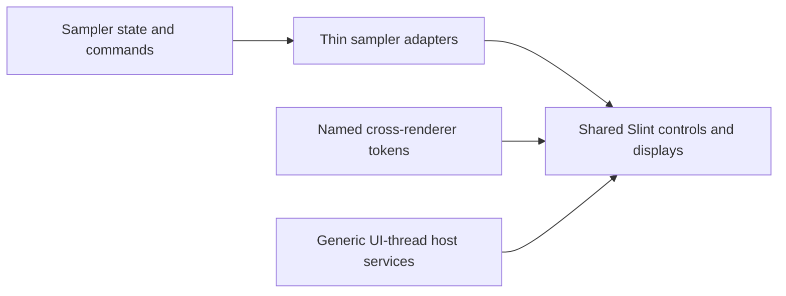

# Shared editor extraction

The advanced sampler composes the shared design library. Its adapters supply
application state, command dispatch and instrument policy; controls render data
and emit semantic events. The original guide components retain their public API.
The editor variants retain the measured v3 geometry and interaction defaults.



## Reusable boundaries

| Boundary | Library implementation | Sampler responsibility |
| --- | --- | --- |
| Theme/material/icons | `editor/Theme.slint`, `Material.slint`, `Icon.slint`; `host/Theme.h`, `MaterialImage.h` | Selected appearance and application icon aliases |
| Parameter controls | `ParameterKnob`, `ParameterField`, `ParameterGesture`, menus, value editor/popup, rotary drawing | Parameter IDs, models, automation and command transport |
| Input lifetime | `RangeGesture`, `DelayedPopupState`, `TransientState`, `EditorDragSource/Target`, `EditorModal` | Whether a workflow accepts dismissal/drop and when notes must stop |
| Chrome and forms | Navigation, item/status/property rows, empty state, text/search fields, choices, level meter, panels and resize handles | Tree/domain selection, page composition, capability rules |
| Browser | `PresetBrowser`, `PresetFilter`, `PresetRow`, `host/SearchFilter.h` | Presets and load/favourite callbacks |
| Supplied-data displays | Keys, pads, pad panel, wave previews, editable waveform, keyboard fit, key-map overview, editable zone map | Mapping records, sample data and audition/note ownership |
| Editable graphs | Filter/envelope/modulator/processor/velocity plots and range handles | DSP parameter definitions and gesture dispatch |
| Native helpers | Stable model projection, spectral/velocity previews, appearance parsing/binding, file URI parsing and optional X11 transport | File opening, worker jobs, native application window identity |

The public surface is [dandrum.slint](dandrum.slint); the checked inventory is
[components.json](components.json). `EditorPropertyRow`, `EditorEmptyState` and
`EditorRotaryFace` distinguish editor variants from existing guide APIs.

```slint
import { ParameterKnob, GraphMetrics, Tokens } from "dandrum.slint";
// The consumer supplies its parameter model and handles the emitted edit.
ParameterKnob {
    label: "Cutoff";
    minimum: GraphMetrics.frequency-minimum;
    maximum: GraphMetrics.frequency-maximum;
    unit: Tokens.editor-control-unit-hertz;
}
```

## Named defaults and protocols

[tokens.json](../design-system/tokens.json) owns shared colours, dimensions,
typography, timing, labels and rendering calibration. Generation produces Slint,
CSS, legacy Slint and two independent C++ namespaces. Duration tokens retain
their units; `#RRGGBBAA` colours preserve alpha and generate native ARGB correctly.
Purpose-specific dimensions remain independent even when their default values
are equal. Viewport height, dialog width and grid stride are distinct roles.

Named public vocabularies include `ParameterActions`, `ParameterStrings`,
`GesturePhases`, `RangeFields`, `DragKinds`, `MusicalConstants`, `PitchNames`,
`Ranges`, `GraphMetrics`, `DisplayStates`, `DisplayModes`, `WaveFields`,
`EnvelopeStages`, curve constants, layout/dialog metrics and appearance choices.
Pitch/keyboard tables and ADSR indices are explicit protocol data. Ordinary zero,
one, midpoint arithmetic, character syntax and authored SVG geometry remain
literal where naming them would obscure their meaning.

The sampler's 205 command IDs have a separate authority,
[commands.json](../advanced-sampler/domain/commands.json). It generates named
Slint and C++ constants with the existing ordering and values. Navigation,
workflow copy and silent-render policy stay in sampler `domain/UiConstants.slint`
and `domain/RenderConstants.slint`. Shared code has no sampler/Session dependency.

```sh
node scripts/generate-ui-tokens.mjs --check
node scripts/generate-sampler-commands.mjs --check
```

## Verification

The package test copies only `ui/slint` and the licensed shared fonts into a
standalone consumer. It imports the complete public surface and native headers,
then configures/builds with catalog, tests and file-drop targets disabled. This
proves that linking the design library does not pull in the sampler or engine.
The package guard checks every Slint/C++ source for application dependencies.

Ten independent native editor fixtures cover controls/theme, parameters,
dialogs/drag, browser, chrome, displays, plots, zone map, collections and
modulation/layers. Six fixtures also run the actual software renderer and assert
pixels. Existing sampler model, binding, pointer, rendering, file-drop and
launcher contracts remain required integration evidence.

Focused independent evidence before the final integrated build:

- Parameter controls: 101 native checks, plus existing guide codec/interaction
  consumers. First-start, expiry, refresh, reset, wheel, disabled/read-only
  cancellation and persistent automation are covered. Eight focused constants
  and timer mutations are killed.
- Theme/chrome/browser: 376 theme/control, 164 browser and 31 chrome interaction
  checks; 16 chrome renderer pixel checks. Native search includes matches beyond
  row 64 and Unicode queries. The viewer-only fallback remains bounded to 64 rows.
- Displays/plots/mapping/collections: 125 interactions and 54 renderer pixel
  checks. Modulation/layer plots add 145 interactions and eight pixel checks;
  calibrated paths and paired images are byte-identical after extraction. A
  further live-model regression verifies both velocity edges across refresh,
  repeated drag and cancellation (44 zone-map checks).
- Dialog/drag: 42 native checks, including nested popup focus, dismissal and
  deactivation. Real X11 transport completes 17 exchanges, including a drop after
  the receiving component expires with no callback.
- Projection: 2,866 checks, including identity preservation, linear read bounds
  and propagation of a consumer model failure. GCC source coverage is 29/29
  executable lines. File URI parsing is 35/35; spectral preview is 72/72; velocity
  blending is 14/14; the numeric codec is 65/65. Coverage excludes standard-library source, and Slint itself
  has behavioral evidence rather than a claimed source-line percentage.
- Four focused projection/URI mutations are killed. Codec and command-generator
  mutants independently reject changed units, precision, registry values and
  stale generated outputs. Generic C++ string callbacks additionally preserve
  explicit lengths (66 checks and three focused mutants); the real Slint SDK
  retains its documented no-embedded-NUL string contract.

Actual audio, physical MIDI devices, external DAW hosting and other operating
systems are outside this presentation refactor's verification. The advanced
sampler remains an explicitly silent native editor; its broader OpenSpec roadmap
is not completed by this extraction.
